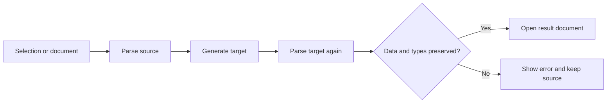

# Transformer

Version 1.13.0 adds Chinese-English spacing, local cURL code generation, encoding and crypto tools, and validated data format conversion


- Provides enhanced editing capabilities which operate on either current document or can pipe output to a new document.
- Most commands implement auto scoping to select current block, document or selection as the target of an operation.
   - A block refers to code that has an empty line above and below.

## Features

* [Chinese-English Spacing](#chinese-english-spacing)
* [Convert cURL to Code](#convert-curl-to-code)
* [Encoding and Crypto Tools](#encoding-and-crypto-tools)
* [Data Format Conversion](#data-format-conversion)
* [Align CSV](#align-csv)
* [Align To Cursor](#align-to-cursor)
* [Compact CSV](#compact-csv)
* [Copy To New Document](#copy-to-new-document)
* [Count Duplicate Lines As New Document](#count-duplicate-lines-as-new-document)
* [Encode / Decode](#encode-/-decode)
* [Filter Lines As New Document](#filter-lines-as-new-document)
* [Filter Lines](#filter-lines)
* [Join Lines](#split-lines)
* [JSON String As Text](#json-string-as-text)
* [Lines As JSON String Array](#lines-as-json-string-array)
* [Normalize Diacritical Marks](#normalize-diacritical-marks)
* [Randomize Lines](#randomize-lines)
* [Randomize Selections](#randomize-selections)
* [Reverse Lines](#reverse-lines)
* [Reverse Selections](#reverse-selections)
* [Rotate Backward Selections](#rotate-backward-selections)
* [Rotate Forward Selections](#rotate-forward-selections)
* [Select Highlights](#select-highlights)
* [Select Lines](#select-lines)
* [Selection As JSON String](#selection-as-json-string)
* [Sort Lines By Length](#sort-lines-by-length)
* [Sort Lines](#sort-lines)
* [Sort Selections](#sort-selections)
* [Split Lines After](#split-lines)
* [Split Lines Before](#split-lines)
* [Split Lines](#split-lines)
* [Trim Lines](#trim-lines)
* [Trim Selections](#trim-selections)
* [Unique Lines As New Document](#unique-lines-as-new-document)
* [Unique Lines](#unique-lines)

### Encoding and Crypto Tools

Run `Transform: Encoding / Crypto Tools...` to choose a conversion. All selections are processed independently; an empty cursor processes its current line. Ordinary conversions validate every selection before applying all replacements in one undo step. If any selection is invalid, nothing is replaced. Identical current-line ranges are processed once, and overlapping selections are rejected

| Category | Operations |
| --- | --- |
| Text encodings | UTF-8 Base64, Base64URL, Hex, URL, URL Component, form URL encoding |
| Escapes | HTML entities, decimal HTML entities, XML entities, Unicode escapes, JSON strings |
| Bytes | Text to/from JSON byte arrays, Base64 to/from byte arrays, Hex to/from byte arrays |
| Integers | Decimal integers to/from Crockford Base32 |
| Hashes | MD5, SHA-1, SHA-256, SHA-512, each as Hex or Base64 |
| Keyed hashes | HMAC-SHA256 and HMAC-SHA512, each as Hex or Base64 |
| Encryption | Password-based AES-256-GCM encryption and decryption |

Inspired by [mitchdenny/ecdc](https://github.com/mitchdenny/ecdc). The older `Transform: Encode / Decode...` command keeps its existing behavior. The new tools use UTF-8, including Chinese and emoji. Byte arrays accept integers from 0 through 255; text decoders reject invalid UTF-8, while byte-to-byte conversions can preserve arbitrary binary bytes. Crockford conversion accepts nonnegative integers through `9007199254740991`, supports case-insensitive input, hyphens and the `O`/`I`/`L` aliases, and does not use the optional checksum

Hash and HMAC results are one-way values. HMAC keys are literal UTF-8 text entered in a masked prompt. These operations do not decrypt hashes

AES asks for a password in a masked prompt and opens its result in a new unsaved document, leaving the source intact. Multiple selections produce separate result documents. Cancelling the password prompt produces no output. Passwords are not persisted, and processing stays on the local machine

Encrypted text is a JSON envelope with `version`, `algorithm`, `kdf`, `salt`, `iv`, `tag` and `ciphertext`. Version 1 uses AES-256-GCM, a 16-byte random salt, a 12-byte random IV and a 16-byte authentication tag. The key is derived with scrypt (`N=16384`, `r=8`, `p=1`, 32-byte key), and the authenticated metadata is the UTF-8 string `transformer:aes256gcm:v1`. Binary fields use Base64. Fresh randomness produces different envelopes for the same text and password; the password and envelope are both needed for decryption. Incorrect passwords, unsupported envelope versions and authentication failures produce an error without replacing source text

### Data Format Conversion

Run `Transform: Convert Data Format...`, choose the source format, then the target format. The current document's language or filename puts the likely source format first in the menu. The command reads the primary selection or the whole document when that selection is empty, and opens the result in a new unsaved document with available syntax highlighting

All 30 distinct source/target pairs between JSON, YAML, XML, Properties, TOML and INI are available. Conversion is for data rather than original formatting: comments, indentation, quoting style and object-key order are not preserved



The second parse checks that the target retains the supported structure and value types. A format pair being available does not mean every value can be represented in both formats. Unsupported mappings fail rather than silently dropping data or coercing types

| Format | Mapping and limits |
| --- | --- |
| JSON and YAML | Objects, arrays, strings, booleans, finite numbers and null are supported; unsafe integer values, YAML sets, binary tags, cyclic aliases and non-string keys are rejected |
| TOML | Requires an object at the root; null and types that cannot fit the common data model are rejected, including native timestamp values rather than quoted date strings |
| XML | Preserves the root element, maps attributes to `@_name`, text with attributes to `#text`, and repeated elements to arrays; mixed content and interleaved repeated element groups are rejected because their order cannot fit this mapping |
| Properties | Dot-separated keys become nested objects and values stay strings; output requires nested objects with string leaves, with no empty or literal dotted keys, duplicate paths, empty nested objects or arrays |
| INI | Sections form nested objects, values stay strings, and `key[]` entries form arrays of strings; entries must use `key=value`, and duplicate scalar keys or conflicting paths are rejected |

For example, `{"app":{"port":"8080"}}` converts to an INI `[app]` section with `port=8080`. The numeric JSON value `8080` instead of the string `"8080"` is rejected for INI because re-importing it would change its type to a string

XML output uses an existing single root key when possible. Otherwise it adds `<root>`; a top-level array is represented under `<root><item>…</item></root>`. XML has no native numeric, boolean or null types, and singleton arrays cannot be inferred from a lone element, so those mappings fail when type or array shape would be lost. XML declarations and layout-only whitespace between elements are omitted; DTDs, custom entities, invalid XML characters and reserved object keys are rejected. The keys `__proto__`, `constructor` and `prototype` are reserved throughout the common data model

### Chinese-English Spacing

Run `Transform: Add Chinese-English Spacing` to insert spaces between Chinese characters and adjacent English letters or digits. It processes all selections, or the current line for each empty cursor. Run `Transform: Add Chinese-English Spacing in Document` to process the whole document

```text
使用VSCode处理100行文本
使用 VSCode 处理 100 行文本
```

The commands preserve punctuation, existing whitespace and line endings. English letters and numbers stay together, so `English123` is unchanged. Repeating the command does not add more spaces, and each operation uses a single undo step. These commands format text, including selected code, without interpreting its programming language

Inspired by [vscode-pangu](https://github.com/halfcrazy/vscode-pangu). Formatting runs only when you invoke a command

### Convert cURL to Code

Select a curl command and run `Transform: Convert cURL to Code...`. Without a selection, the command reads the current document. Choose a language and HTTP client library to open the generated code in a new unsaved document. The original text stays intact, and cancelling the menu opens nothing

The converter uses Postman's open-source [curl importer](https://github.com/postmanlabs/curl-to-postman) and [code generators](https://github.com/postmanlabs/postman-code-generators). The menu includes all 33 non-cURL variants supplied by the pinned generator version, across 19 language and output groups

| Language or output | Client libraries |
| --- | --- |
| C | libcurl |
| C# | HttpClient, RestSharp |
| Dart | dio, http |
| Go | Native |
| HTTP | HTTP |
| Java | OkHttp, Unirest |
| JavaScript | Fetch, jQuery, XHR |
| Kotlin | Okhttp |
| Node.js | Axios, Native, Request, Unirest |
| Objective-C | NSURLSession |
| OCaml | Cohttp |
| PHP | cURL, Guzzle, HTTP_Request2, pecl_http |
| PowerShell | RestMethod |
| Python | http.client, Requests |
| R | httr, RCurl |
| Ruby | Net::HTTP |
| Rust | reqwest |
| Shell | Httpie, wget |
| Swift | URLSession |

For example, select the following request and choose `Python - Requests`

```sh
curl 'https://example.com/api/items' \
  -H 'Content-Type: application/json' \
  --data-raw '{"name":"demo"}'
```

Parsing and generation run locally without executing curl or sending an HTTP request. Supported request features follow the Postman importer, including common headers, authentication, query strings, JSON, form bodies and shell line continuations. This is request conversion rather than a shell interpreter: shell variables, command substitution and arbitrary curl flags are not guaranteed to translate. File references remain references rather than uploading or reading local files

Generated code keeps request credentials when they are part of the input. The chosen language's libraries must be installed in the destination project. Syntax highlighting uses installed VS Code language support, with plain text as the fallback. This feature does not use Postman accounts, collections or cloud services

### Unique Lines
- Removes duplicate lines from the document
- Operates on selection or current block if no selection


### Unique Lines As New Document
- Unique lines are opened in a new document
- Operates on selection or current block if no selection


### Filter Lines
- Keep matching lines of filter
- Operates on selection or entire document if no selection
- Filter using regex or literal


### Filter Lines As New Document
- A new document is created with lines matching filter
- Gutter decorators show original line number from original document
- Operates on selection or entire document if no selection
- Filter using regex or literal
- Add lines relative to filtered lines by count and regular expression match
- `Parent Levels` add context by indentation level.  Similar to vscode folding levels. 
  - Examples:
    - `0` will include all siblings of the matched lines.  Where a sibling is determined by being at the same indentation level next to the matched line.
    - `1` will include all siblings + the parent siblings ( one less indentation level )


### Sort Lines
- Sorts by column when there is a vertical stack of multiple cursors using the cursor position to determine sort text for the line.
- Operates on selection or entire document if no selection


### Sort Lines By Length
- Sorts by length of the line
- Operates on selection or current block if no selection


### Align To Cursor
- Aligns text right of cursor to cursor position
- Single cursor will auto expand vertically to block


### Align CSV
- Aligns CSV text into columns.  Can also specify custom delimiter.


### Compact CSV
- Does the opposite of `Align CSV`, removes white space between columns.


### Copy To New Document
- Copies selections to a new document
- Operates on selections or find match results or entire document


### Select Lines
- Expands all current find match results or cursors to full line selections

### Lines As JSON String Array
- Converts each line to a JSON string
- Useful for easily creating snippet bodies with selected text


### Selection As JSON String
- Transform all contents of selection as a single JSON String


### Trim Lines
- Remove whitespace at beginning and end of lines

### Randomize Lines
- Randomize the order of selected lines

### Reverse Lines
- Reverse the order of selected lines

### Count Duplicate Lines As New Document
- Count the number of instances of each unique line


### Encode / Decode
- Encode Base64
- Decode Base64
- Encode URL Segment
- Decode URL Segment
- Encode x-www-form-urlencoded
- Decode x-www-form-urlencoded
- Hash MD5


### JSON String As Text
- unescapes a JSON string to text


### Split Lines
- split lines using specified delimeter

### Split Lines After 
- splits lines after the delimeter while keeping the delimeter

### Split Lines Before
- splits lines before the delimeter while keeping the delimeter

### Join Lines
- join lines using specified delimeter


### Select Highlights
- make selections of all text highlighted in the editor

### Randomize Selections
 - replace selections with random order of selected text
### Reverse Selections
 - replace selections with reverse order of selected text
### Sort Selections
 - replace selections with sorted order of selected text

 

### Trim Selections
 - replace selections with trimmed selected text
### Rotate Forward Selections
 - rotates the order of the selections forward
### Rotate Backward Selections
 - rotates the order of the selections backward
### Normalize Diacritical Marks
 - transforms accented characters to non-accented versions

 
